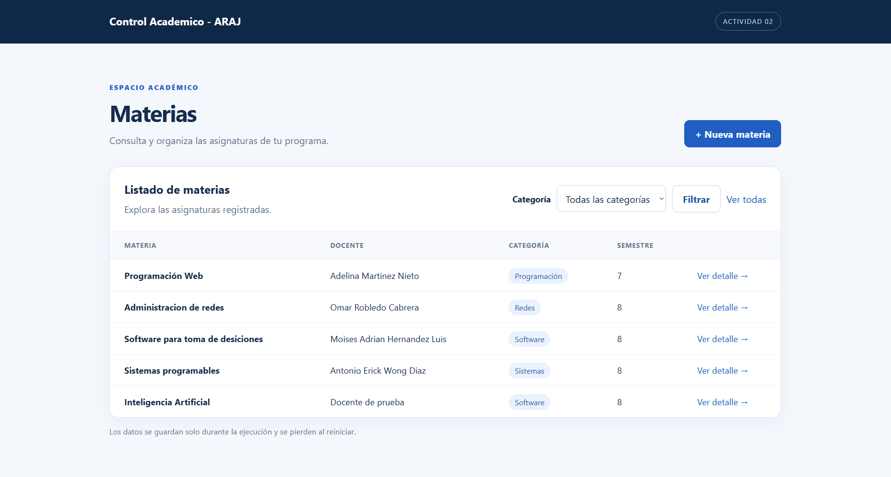
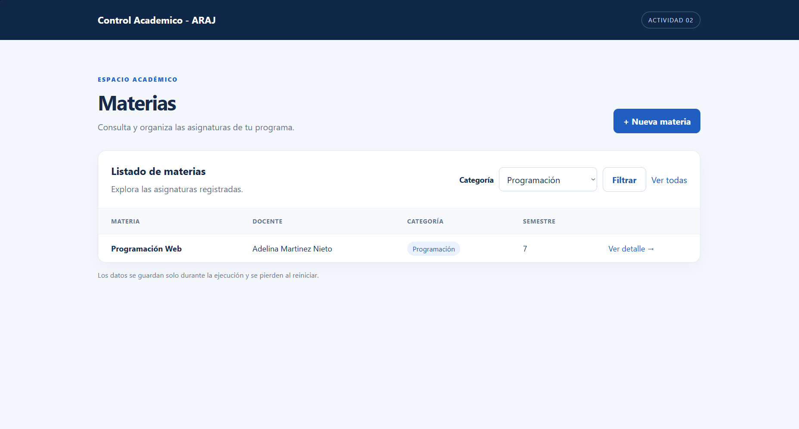
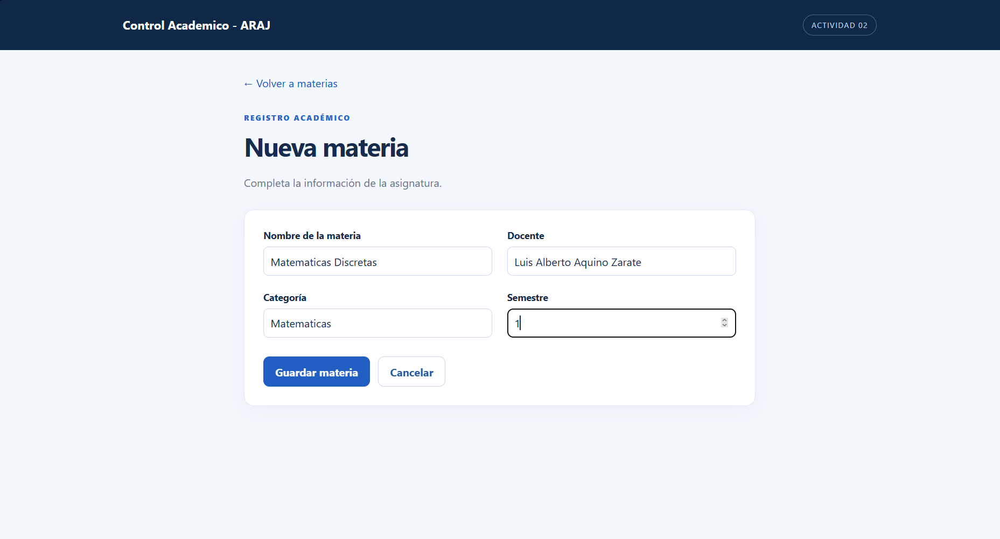
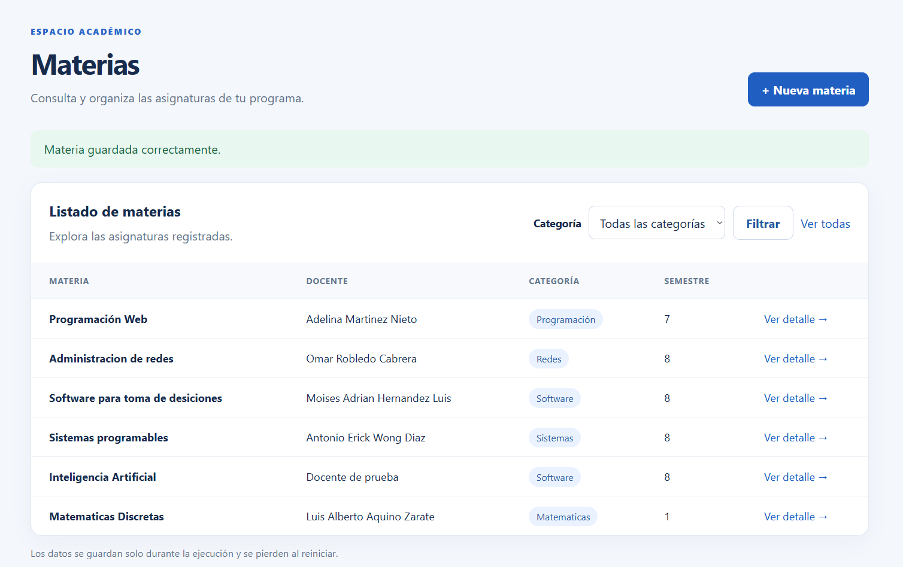
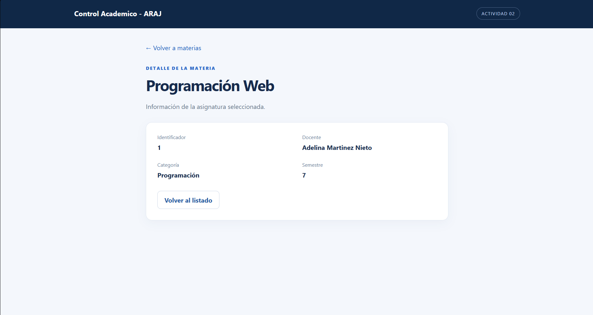
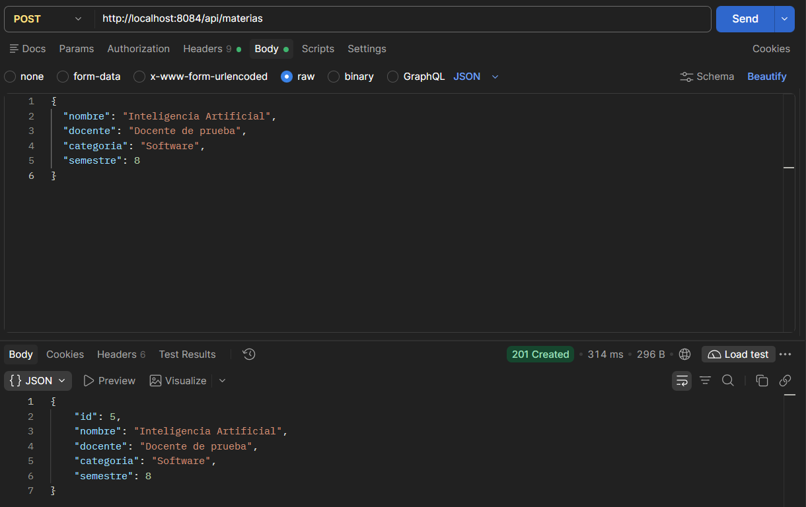

# Actividad 2: Control Académico - ARAJ

Aplicación de Programación Web con Spring Boot 4.1.2, Spring Web MVC, Thymeleaf, HTML, CSS y Maven Wrapper. Compila para **Java 17**; puede ejecutarse localmente con JDK 23. Se conserva el paquete `com.ejemplo.act1` y la vista de práctica `/detalles_info`.

## Patrón MVC y datos

En el patrón MVC, `MateriasService` gestiona los datos del modelo, `MateriasMvcController` recibe las solicitudes y coloca datos en `Model`, y las plantillas Thymeleaf generan las vistas HTML. Por ejemplo, el controlador prepara la lista y la vista recorre sus elementos:

```java
model.addAttribute("materias", servicio.listar(categoria));
```

```html
<tr th:each="materia : ${materias}">
```

`MateriaDTO` transporta `id`, `nombre`, `docente`, `categoria` y `semestre` entre el servicio, las vistas, el formulario y JSON. `Materia` se conserva para mantener el formato anterior de `GET /api/materias`. `MateriasController` atiende la API REST; `ProyectoController` y `EjemploController` conservan el endpoint de información del proyecto y la vista de práctica anteriores.

El formulario usa `th:object`, `th:field` y `@ModelAttribute`; el listado usa `th:each`, el filtro `@RequestParam`, el detalle `@PathVariable` y el POST REST `@RequestBody`. `@Value` lee `proyecto.nombre` de `application.properties`. El servicio asigna los identificadores: se ignora cualquier `id` recibido. Nombre, docente y categoría son obligatorios; el semestre debe estar entre 1 y 12. Las categorías de las cuatro materias originales son ejemplos.

**Los datos se comparten entre la interfaz y la API únicamente durante la ejecución; se pierden al reiniciar.** No existe base de datos.

## Ejecución local

En `D:\Spring\act2`, con JDK 17 o superior y acceso a las dependencias Maven:

```powershell
.\mvnw.cmd clean verify
.\mvnw.cmd spring-boot:run
```

En Linux/macOS use `./mvnw`. Abra `http://localhost:8084/materias`. El puerto configurado es **8084**. Compruebe su disponibilidad antes de iniciar. `proyecto.iniciales=ARAJ` sigue configurado para la API heredada.

## Rutas

| Método | Ruta | Uso |
| --- | --- | --- |
| GET | `/materias` | Listado HTML; `?categoria=Redes` filtra por categoría. |
| GET | `/materias/nueva` | Formulario. |
| POST | `/materias/guardar` | Procesa el formulario y redirige al listado. |
| GET | `/materias/{id}` | Detalle; 404 si no existe. |
| GET | `/detalles_info` | Vista de práctica heredada. |
| GET | `/api/proyecto` | Texto de la Actividad 1 e iniciales configuradas. |
| GET | `/api/materias` | JSON heredado: `id`, `nombre`, `docente`, incluyendo nuevas materias. |
| GET | `/api/materias/total` | Total de materias. |
| POST | `/api/materias` | Crea con JSON, responde 201 con DTO completo o 400 si es inválido. |

Para probar el formulario, entre en `/materias/nueva`, complete los cuatro campos y pulse **Guardar materia**. La redirección muestra una confirmación y el registro en el listado; compruebe también el filtro y el detalle.

## POST con Postman o Bruno

Configure `POST http://localhost:8084/api/materias`, cabecera `Content-Type: application/json` y cuerpo raw JSON:

```json
{
  "nombre": "Ingeniería de software",
  "docente": "Pepe Ramirez",
  "categoria": "Software",
  "semestre": 4
}
```

La respuesta válida es HTTP 201 e incluye los cuatro campos y el `id` asignado. La cabecera `Location` apunta al detalle HTML. Errores de validación devuelven HTTP 400 con mensajes por campo; JSON mal formado también devuelve 400.

## Evidencias de funcionamiento

Las siguientes capturas muestran resultados de la aplicación; las anotaciones y directivas mencionadas describen la implementación que produce cada vista, no código visible en las imágenes.

### 1. Listado de materias

El listado muestra las materias antes de registrar Matemáticas Discretas, incluida Inteligencia Artificial creada en la prueba REST. En la implementación MVC, el controlador entrega la colección mediante `Model` y Thymeleaf genera las filas con `th:each`. El encabezado muestra el nombre configurado en `application.properties`, leído por el controlador mediante `@Value`.



### 2. Filtro por categoría

Al seleccionar la categoría Programación, el listado muestra únicamente Programación Web. El controlador recibe el parámetro opcional `categoria` mediante `@RequestParam` y entrega la lista filtrada a la vista.



### 3. Formulario de nueva materia

El formulario contiene los datos de Matemáticas Discretas antes de enviarlos. Thymeleaf enlaza los campos con `MateriaDTO` mediante `th:object` y `th:field`; el controlador recibe el formulario con `@ModelAttribute` y valida los datos.



### 4. Confirmación del registro

Después de guardar, se observa el mensaje de confirmación y la nueva materia en el listado. El controlador guarda el DTO en el servicio y redirige al listado siguiendo Post/Redirect/Get.



### 5. Detalle de una materia

La vista presenta el identificador, docente, categoría y semestre de Programación Web. En la implementación, `@PathVariable` recibe el ID de `/materias/{id}` para consultar la materia y añadirla al `Model`.



### 6. Creación mediante Postman

Postman envía JSON a `POST /api/materias` y muestra la respuesta **201 Created**, con los datos de Inteligencia Artificial y el ID asignado. El controlador REST recibe el JSON en un `MateriaDTO` mediante `@RequestBody` y lo guarda en la misma colección utilizada por las vistas.



## Despliegue en DigitalOcean

La aplicación está desplegada en un VPS Ubuntu de DigitalOcean, en el puerto **8084**:

- Aplicación web: [http://204.48.17.197:8084/materias](http://204.48.17.197:8084/materias)
- API REST: [http://204.48.17.197:8084/api/materias](http://204.48.17.197:8084/api/materias)

El despliegue utiliza Java 17 y Maven para compilar la aplicación, SSH para administrar el servidor, SCP para transferir el JAR y systemd para ejecutar el servicio `spring-act2-araj`. La Actividad 1 utiliza el puerto **8082** y debe seguir funcionando sin modificaciones.

En el VPS, se puede verificar el estado del servicio y consultar sus registros con:

```bash
sudo systemctl status spring-act2-araj
sudo journalctl -u spring-act2-araj -n 100 --no-pager
sudo journalctl -u spring-act2-araj -f
```

El último comando sigue los registros en tiempo real; se detiene con `Ctrl+C`.

### Actualización del JAR

Después de realizar cambios, desde Windows, en la carpeta del proyecto, compile y copie el JAR a un archivo temporal en el VPS. Sustituya `<usuario>` por el usuario SSH correspondiente:

```powershell
.\mvnw.cmd clean verify
scp .\target\act2-0.0.1-SNAPSHOT.jar <usuario>@204.48.17.197:/tmp/act2-0.0.1-SNAPSHOT.jar
ssh <usuario>@204.48.17.197
```

Una vez conectado al VPS, reemplace el JAR desplegado y reinicie únicamente el servicio de la Actividad 2:

```bash
sudo systemctl stop spring-act2-araj
sudo cp /tmp/act2-0.0.1-SNAPSHOT.jar /opt/spring-act2-araj/act2-0.0.1-SNAPSHOT.jar
sudo systemctl start spring-act2-araj
sudo systemctl status spring-act2-araj
```

Las materias se almacenan en memoria, sin base de datos: los registros agregados se pierden al reiniciar la aplicación, incluida una actualización del JAR.
